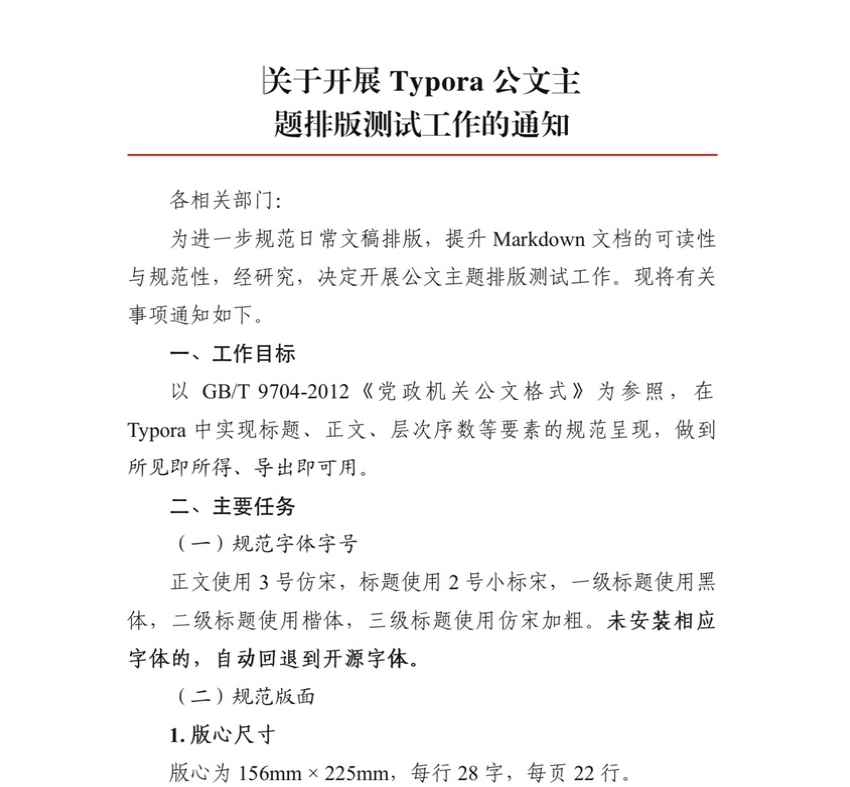
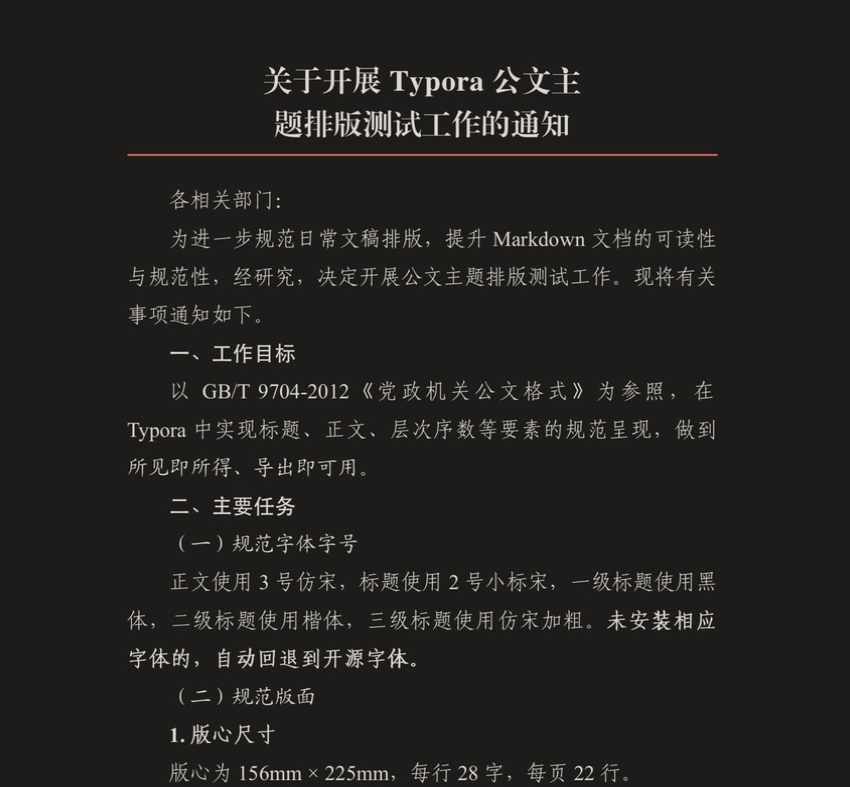

# Gongwen 公文 · Typora Theme

按照 **GB/T 9704-2012《党政机关公文格式》** 排版的 Typora 主题，提供亮色（Gongwen）与暗色（Gongwen Dark）两个版本。

A Typora theme that follows the Chinese official document standard GB/T 9704-2012, in light and dark variants.





## 特性

- **标题**：2 号（22pt）方正小标宋，居中，下空一行
- **正文**：3 号（16pt）仿宋，首行缩进 2 字，两端对齐，每行 28 字
- **层次序数自动编号**：`##` 黑体 · `###` 楷体 · `####` 仿宋加粗 · `#####` 仿宋，主题会自动加上“一、（一）1.（1）”，增删标题后自动重排，无需手打
- **版头反线**：`---` 渲染为红色分隔线
- **数字与西文**：标题、正文、各级标题、表格、引用中的英文和数字一律使用 Times New Roman
- **高亮与下划线**：`==高亮==` 为荧光笔黄色，`<u>下划线</u>` 为与文字同色的普通下划线
- **导出 PDF**：A4 纸，页边距为上 37mm、下 35mm、左 28mm、右 26mm，固定行距约 28.95pt（每页 22 行）
- **暗色版**：暖墨色底，配色单独调过而不是简单反色；导出 PDF 时自动换回白纸黑字
- **其他元素**：列表、表格（4 号字、黑体表头、全框线）、引用（楷体）、代码块、脚注、目录、任务列表都有对应样式；中文强调（`*斜体*`）用楷体代替斜体

## 写法对照

| Markdown | 公文要素 | 字体 |
| --- | --- | --- |
| `# 关于……的通知` | 标题 | 小标宋 22pt |
| `## 工作目标` → 一、工作目标 | 一级标题 | 黑体 16pt |
| `### 规范字体` → （一）规范字体 | 二级标题 | 楷体 16pt |
| `#### 版心尺寸` → 1.版心尺寸 | 三级标题 | 仿宋加粗 16pt |
| `##### 上下边距` → （1）上下边距 | 四级标题 | 仿宋 16pt |
| `---` | 版头红色反线 | — |
| `<p align="right">单位<br>日期</p>` | 落款 | 仿宋 16pt |

完整示例见 [example.md](example.md)。

> 序数由 CSS 生成，在 Typora 中显示和导出 PDF 时都会出现；但复制文字或导出 Word / HTML 源码时不包含序数。如果需要手动编号，可在 `gongwen.user.css` 中加入 `#write h2::before, #write h3::before, #write h4::before, #write h5::before { content: none; }` 关闭自动编号。

## 字体

本主题**不附带任何字体文件**，只调用你电脑上已安装的字体。每一类字体都会先找公文常用字体，找不到再依次换成开源免费的替代字体：

| 用途 | 优先使用 | 开源 / 系统平替 |
| --- | --- | --- |
| 标题 | 方正小标宋简体 | 思源宋体 Heavy → Noto Serif SC Black → 宋体-简 / 华文中宋 |
| 正文 | 仿宋_GB2312 / 仿宋 | 华文仿宋 → 朱雀仿宋 |
| 一级标题 | 黑体 | 黑体-简 → 思源黑体 → 苹方 |
| 二级标题 | 楷体_GB2312 / 楷体 | 楷体-简 / 华文楷体 → 霞鹜文楷 |

> 方正小标宋是方正字库的商用字体，请通过正规渠道获取授权。没有安装时，推荐装开源的[思源宋体](https://github.com/adobe-fonts/source-han-serif)（SIL OFL 1.1），它的 Heavy 字重和小标宋的观感比较接近。

## 安装

1. 下载并解压本仓库。
2. 在 Typora 中打开 **偏好设置 → 外观 → 打开主题文件夹**。
3. 将 `gongwen.css` 和 `gongwen-dark.css` 复制到主题文件夹（暗色版依赖亮色版，两个文件要一起放）。
4. 重启 Typora，在 **主题** 菜单中选择 **Gongwen** 或 **Gongwen Dark**。

## 导出 PDF 建议

Typora 的 PDF 导出设置会覆盖主题中的页边距，建议在 **偏好设置 → 导出 → PDF** 中这样设置：

- 纸张：A4
- 页边距：上 37mm、下 35mm、左 28mm、右 26mm
- 页脚：居中填写 `— ${pageNo} —`，即公文页码样式

## 自定义

可以在主题文件夹中新建 `gongwen.user.css`（暗色版对应 `gongwen-dark.user.css`）覆盖变量，例如：

```css
:root {
  --gw-red: #c00000;      /* 反线颜色 */
  --gw-page-padding: 80px; /* 编辑区左右留白 */
}
```

## 许可

[MIT License](LICENSE)
